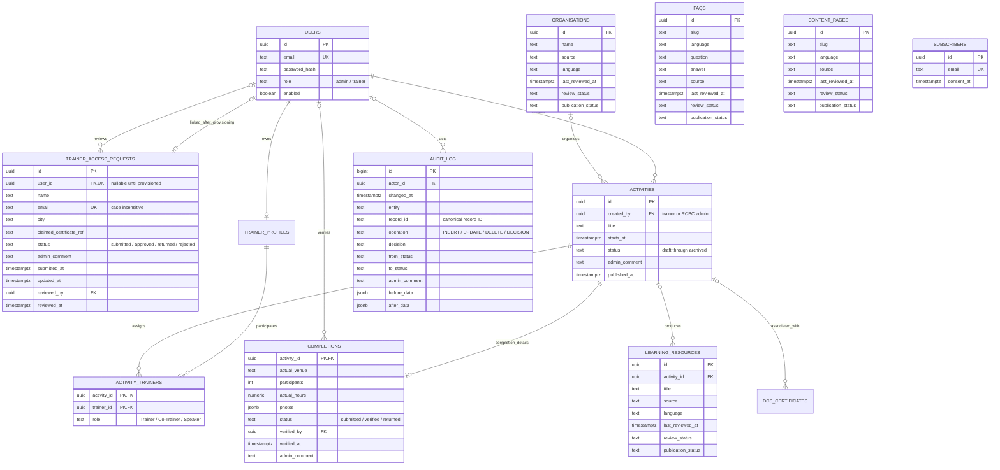

> Implementation update: this design is now connected to the application. The active migration is `005_admin_workflow.sql`, followed by `006_portal_operations.sql` and `007_content_feedback.sql`. The `.draft.sql` file is retained as a historical design reference and must not be replayed. Login and session validation now require approved trainer access. See [the current implementation and test guide](portal-api.md). The draft discussion below records the original proposal, not remaining implementation tasks.

# Admin schema / ERD for Trainer Portal and Admin Dashboard

This extends the existing shared-record model for the `branch/admin-dashboard` screens described in the request. The current workspace screens were checked; no branch switch or API behavior changes were made. Reviewable SQL: [005_admin_workflow.draft.sql](../database/005_admin_workflow.draft.sql). Base tables: [001_shared_records.sql](../database/001_shared_records.sql), [003_admin_auth.sql](../database/003_admin_auth.sql), [004_record_details.sql](../database/004_record_details.sql).

**Implemented:** the reviewed extension is active as `005_admin_workflow.sql`, followed by operational migrations 006 and 007. The historical `.draft.sql` is not run. Trainer login and session checks require approved access and active certification.

The earlier [shared-record ERD](shared-records-erd.md) supplies the complete profile, activity, subscriber and certificate field lists. This draft supersedes its access-approval and directory review-state design.

## Screen-to-field mapping

| Screen / control | Database fields / rule |
| --- | --- |
| Trainer access request | `trainer_access_requests.name, email, city, claimed_certificate_ref, submitted_at` |
| Access review status and comment | `status, admin_comment, reviewed_by, reviewed_at`; reject/return requires a comment |
| Access request date vs latest action date | `submitted_at` is initial application date; `updated_at` is most recent change; audit retains resubmission dates |
| Official trainer certificate | `trainer_profiles.certificate_ref`; applicant's claimed reference never overwrites the official reference automatically |
| Trainer profile approval | `trainer_profiles.status`; independent of access-request status and certification status |
| Activity review queue | `activities.status='submitted'`; same activity ID throughout |
| Publish / archive | `activities.status`, `published_at`; creator stored in `created_by` and role obtained by joining `users` |
| Completion verification | `completions.activity_id, actual_venue, participants, actual_hours, photos, status, verified_by, verified_at, admin_comment` |
| Recent decisions | `audit_log WHERE operation='DECISION'`, joined to `users` for the admin name; order by `changed_at DESC, id DESC` |
| Find Help / resource / FAQ review | Respective canonical table: `source, source_url, language, last_reviewed_at, next_review_at, review_status, publication_status` |
| Contribution and annual summary | Existing `annual_trainer_contributions` and `annual_project_reach` views; no writable hours table |

## Access approval and activation

One application per case-insensitive email, with the same request ID retained for returned/resubmitted requests. Application states are `submitted -> approved / returned / rejected`; `returned -> submitted` supports amendments. Rejected requests remain inactive; reopening requires an explicit RCBC action and audit entry. This is not a public account role. Request identity/contact values are the submitted application snapshot; the user/profile remain the canonical identity after approval.

Recommended flow: accept an application without creating an active account; RCBC verifies identity and certificate; approve and provision/link the trainer user/profile in the same transaction; issue a one-use activation flow for the trainer to choose a hashed password. Alternatively, if credentials are collected at application time, keep the trainer disabled until approval. Never store a password in the request table or audit log.

Login **and every authenticated trainer request** must check `users.enabled`, role `trainer`, and the linked access request's status `approved` (the `approved_trainer_accounts` view expresses this gate). A login check alone leaves existing sessions usable after rejection/return. Pending/returned applicants can receive an application reference and use a narrowly scoped, separately verified amendment flow; it must not grant portal access. Admins retain internally issued accounts and have no public signup.

Do not auto-approve existing sample profiles. Before rollout, reconcile real legacy trainers and create reviewed linked access requests for those RCBC has actually approved. The draft intentionally does not backfill approvals.

## Activity lifecycle and authorship

`draft -> submitted -> approved -> published -> completed -> verified -> archived`.

`submitted -> returned -> submitted` handles amendments. `created_by` references a user whose role is `trainer` or `admin`; do not add a redundant creator-type column that can disagree with that user. The `activity_creators` view supplies creator name and role. Preserve the creator when another admin edits the record; audit records the editor. A future role-change feature would need an immutable creation-role snapshot; role changes are outside this two-role design.

Both trainers and admins use the **same** activities and assignments. The API and admin activity-authoring screen both write these shared records. Publication must set `published_at`; completion submission changes the activity to completed and inserts/updates its one completion extension. Admin verification updates both completion and activity in one transaction. Archive keeps the completion verified so contribution totals remain available.

## Directory/content maintenance

`review_status`: `current / needs review / archived`. `publication_status`: `published / unpublished`. These are separate because an item may need review while remaining visible, or be current but intentionally unpublished. An archived item must be unpublished; database checks enforce that. Marking current requires a last-reviewed date. Source may be a reference description, plus an optional source URL. Use the record's language for its content; organisation `languages[]` continues to describe languages of service.

Correction updates the canonical record and records the change. Unpublish hides it without deleting it; archive preserves history and removes it from public results. Public APIs must filter publication status and exclude archived records. Whether an overdue review automatically unpublishes a record is an RCBC policy decision; this draft does not silently do so.

The existing `status` fields continue to hold editorial approval/verification workflow during migration. They must not be interpreted as review freshness. Update API serializers and public filters to use the two new fields together; do not leave two independently editable publication controls. Existing published/archive values are backfilled to the new columns. FAQs use one canonical `faqs` row per slug/language and can be linked from multiple pages; migrate existing FAQ arrays into these rows, rather than copying them into page bodies.

## Audit and calculated hours

Existing triggers retain before/after field changes. An explicit `DECISION` audit event additionally stores the real decision, admin identity, record type/ID, timestamp, comment, and previous/new states. This avoids displaying SQL `UPDATE` as the decision or losing a repeated approval whose status did not change.

The draft `record_admin_decision(...)` routine checks that the transaction actor is an enabled admin. The backend must set `app.actor_id` from its authenticated session, lock and validate the target record and allowed transition, update it, and call this routine in the **same transaction**. It must verify that `reviewed_by` is the actual admin and that linked request users are trainers. Direct writes must be restricted to the backend role. The routine does not independently enforce target existence or workflow transitions; the API integration owns those checks. No decisions should be emitted for rolled-back or failed updates. Old `UPDATE` logs remain changes; do not invent historical approvals from them.

Verified trainer hours = sum of `completions.actual_hours` for verified completions joined through `activity_trainers`. Group by trainer and activity year in Malaysia time. Participant reach follows the same rule for each trainer. Project-wide participants are summed once per completion, without the trainer join. No independent hours entry, manual total or duplicate completed-activities table is needed.

## Implemented integration

1. Legacy approvals are preserved only where existing admin audit evidence supports certification; sample names never grant access.
2. Access intake, credential-checked applicant amendments, RCBC review, login and session approval gates are connected.
3. Admin decision events commit with the actual record changes, including publication, correction and archive.
4. Review/visibility controls and published managed blocks are connected; existing static editorial content is retained separately, not automatically imported as verified records.
5. Admin event authoring and completion-derived contribution views are active.
6. Migrations are applied locally; isolated-schema integration tests cover access, publication, archive, multi-trainer totals and record management.
