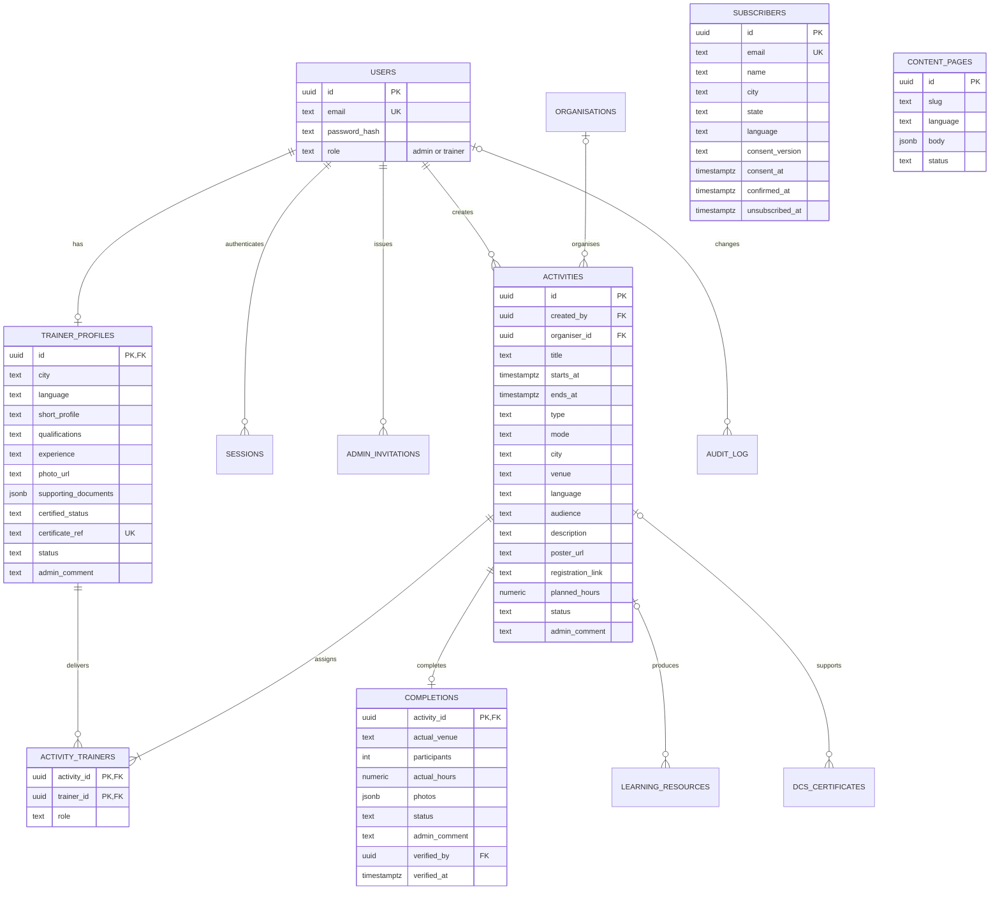

# RCBC shared data model

For the revised Admin Dashboard requirements, see the [Admin schema draft and screen mapping](admin-schema-draft.md). Its access-request, explicit decision-history and content-review design supersedes those parts of this earlier model; the promoted extension and subsequent operational migrations are now applied and connected to the API.

Implemented against the twelve supplied RCBC PDFs and the account/workflow rules in the request. Document proposals are treated as requirements evidence; the user's explicit rules govern this implementation. PostgreSQL is the source of truth for accounts, profiles, activities, trainer assignments, completions and audit history. There are exactly two account roles, `admin` and `trainer`. Visitors and subscribers are not accounts.

`completions` is a one-to-zero-or-one extension of the existing activity, keyed by its activity ID. It does not copy its title, planned date, language or assignments. Published, past and archived activities remain the same row. There is no hours ledger.

## Ownership and state changes

| Record | Trainer permissions | RCBC admin permissions |
| --- | --- | --- |
| Profile | Edit own permitted fields; submit draft/returned/approved profile | Approve or return; verify access and assign certificate reference |
| Activity | Certified trainer creates; owner edits draft/returned records and assigns trainers | Approve/return, publish, archive |
| Completion | Owner submits actual venue, participants, hours and photo links after a published activity happens; returned records can be resubmitted | Verify or return with comment |
| Admin account | None | Created through an RCBC-issued, email-bound invitation |

Profile review status is distinct from certification status. Signing up never grants certification, approval or publication. Submitted records are locked for review. Profile edits hide the profile from the public directory until approved again. Supporting documents and email addresses are excluded from the public trainer view.

Activity state path: `draft -> submitted -> approved -> published -> completed -> verified -> archived`. Submitted activities may be returned, edited and resubmitted. Completion submission sets the same activity to completed; verification sets it to verified. A returned completion remains attached to the completed activity. Return decisions require an admin comment. All writes and their audit entries commit in one transaction. The audit actor comes from the server session; password hashes are never copied into the audit log.

## Calculated reporting

`annual_trainer_contributions` joins verified completions to assignments: every assigned trainer receives the activity's actual hours and participant reach. These are contribution measures, not unique people. `annual_project_reach` aggregates completions before joining trainers so co-trainers do not multiply project reach. Neither measure deduplicates participants attending different activities; individual attendance is outside this model. Annual grouping uses the scheduled date in Asia/Kuala_Lumpur. Archive preserves verified totals. If RCBC later needs different hours per trainer, agree that rule before adding per-assignment actual hours; do not add an independent ledger.

## PDF coverage and extension records

| RCBC source | Model coverage |
| --- | --- |
| 1 HOME; 2 UNDERSTANDING | `content_pages`: translated structured content, sources, reviewer, review dates and publication state |
| 3 FIND HELP | `organisations`: category, services, specialist field, location/address, contact, language, eligibility, fees, opening hours, verification, review/correction/archive |
| 4 EDUCATION | Shared activities/trainers; `learning_resources` optionally references an activity and keeps its own resource approval, language, audience, source and copyright permissions |
| 5 ABOUT | `content_pages.body` holds project team, partners, milestones and approved project information without inventing additional public account roles |
| 6 CONTACT | Existing enquiry API is preserved; project contact details fit approved content. Existing enquiries still use the existing file store |
| 7 LANGUAGE | Language fields on shared content/records; page identity is unique by slug and language |
| 8 GET UPDATED | `subscribers`: required name/email/locality/language, consent timestamp/version, confirmation and unsubscribe timestamps, provider reference; no phone or password |
| 9 TRAINER | One profile, assignments with Trainer/Co-Trainer/Speaker roles, activity submission and verified completion reporting |
| 10 CAREGIVER | Shared organisation support-group/volunteer flags; DCS certificate reference, recipient, programme, issuer, issue/completion dates, location, validity and verification consent |
| 11 ADMIN; DEMENT master | Shared-record review/publication, audit/status history, protected admin access, maintenance dates and archive states |

Directory/resource/subscriber/certificate administration and consent-based certificate verification are implemented through the protected admin and public APIs. The pre-existing directory, static learning materials and public content have not been automatically imported or medically verified. DCS records must never become an open recipient listing: a future verifier should require name plus certificate number and return only consented minimal details. Subscriber collection must validate all required fields, affirmative consent and email unsubscribe before activation. Do not expose these tables through generic public CRUD.

Photo/poster/document uploads now persist in PostgreSQL `files` with ownership checks, an 8 MB limit, MIME signature checks and restricted downloads. Supporting documents remain private. Contact enquiries now persist in PostgreSQL and have an admin follow-up view.

SQL field definitions and constraints are in `database/001_shared_records.sql`, `003_admin_auth.sql`, and `004_record_details.sql`. Migrations are versioned, transactionally applied and safe to rerun; they never seed fake trainers or reset existing records. Use the application's PostgreSQL role only on the backend; the browser receives no database credentials.
