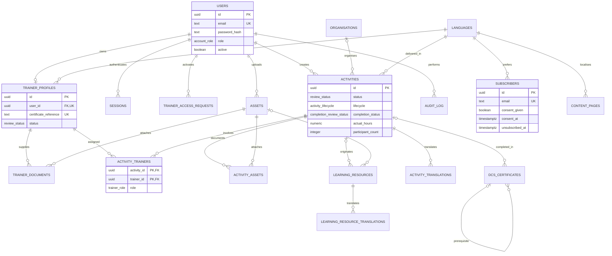

# RCBC shared-record schema and ERD

Updated 17 October 2026. The PostgreSQL model is now connected to the Admin Dashboard, Trainer Portal and the relevant public pages. See [setup, example credentials and walkthrough](admin-dashboard.md).

## Shared record principle

A trainer has one profile, linked one-to-one to their account. Public Certified Trainer pages and the portal use that profile ID. An activity has one ID from draft through publication, completion, verification and archive. Completion facts are columns on the activity, not a second activity table. There is no hours table: annual contribution comes from verified-completion views.

The supplied PDFs are requirements evidence, not instructions to execute. The user's explicit editable-field boundaries govern trainer name/contact access.

## ERD

The audit entity reference is intentionally generic (`entity_table`, `entity_id`), so it is not drawn as a foreign key to every audited table. Enquiries and content pages are additional managed records introduced by migration 002.

## Source-to-field and screen mapping

Page numbers refer to PDF page positions in the supplied RCBC documents.

| Source requirement | PostgreSQL fields / records | Connected screen |
|---|---|---|
| Master `DEMENT_1.PDF`, section 7, pp. 8-9: six shared records | `organisations`, `trainer_profiles`, `activities`, `learning_resources`, `subscribers`, `dcs_certificates` | Public pathways and Admin use the same IDs |
| Input 08 pp. 2-3; Input 11 section 4.4: only Admin and Certified Trainer accounts | `users.email/display_name/password_hash/role/active/created_by/activated_by/activated_at`; `sessions.token_hash/csrf_token/expires_at` | Login/logout; Admin User management; password hashed with Argon2id |
| Input 08 section 3.1: identity/certificate verification before access | `trainer_access_requests.name/email/certificate_reference/city/status/admin_comment/reviewed_by/reviewed_at/user_id` | Request Trainer Access and Admin access review; temporary requested password hash is private, redacted from audit, and cleared upon approval |
| Input 09 section 5: editable trainer profile | `trainer_profiles.city/language_code/short_profile/qualifications/experience/photo_asset_id`; `trainer_documents.asset_id/description` | My Profile; photo and private supporting-document upload |
| Input 09 section 5: Admin-controlled certification | `trainer_profiles.certified_status/certificate_reference/status/admin_comment/reviewed_by/reviewed_at` | Trainer read-only certification fields; Admin approve/return/certification controls |
| Input 09 section 6; Input 04 landing page | `activities.title/starts_at/ends_at/type_code/mode/city/venue/language_code/target_audience/description/poster_asset_id/registration_url/planned_hours` | Workshop/Seminar form, Admin activity editor, public calendar/detail page |
| Input 11 section 4.5; Master section 7 metadata | `activities.organiser_id/timezone/registration_deadline/capacity/registration_closed/status/lifecycle/published_at/archived_at/cancelled_at/cancellation_reason` | Organiser selection, review, publish/unpublish, reschedule/amend, cancel/archive |
| Input 09 section 8: several trainers and roles | `activity_trainers(activity_id,trainer_id,role)` | Admin trainer assignment; Trainer/Co-Trainer/Speaker; one assignment per trainer per activity |
| Input 09 section 7: same activity after completion | `activities.actual_venue/participant_count/actual_hours/completion_status/completion_admin_comment/completion_submitted_by/completion_submitted_at/completion_reviewed_by/completion_reviewed_at/completed_at`; `activity_assets.asset_id/purpose` | Conducted form, photo/material upload and Admin completion verification |
| Input 09 section 8; Input 11 section 4.3: verified contribution | `verified_trainer_contributions`, `trainer_annual_totals`, `project_annual_totals` views | Trainer Dashboard/Hours and Admin contribution views; no second hours-entry form |
| Input 09 section 9; Input 11 section 7: status history | `audit_log.entity_table/entity_id/action/actor_id/changed_at/changed_fields/old_values/new_values/admin_comment` | Admin Audit history; password/token hashes excluded from snapshots |
| Input 03 section 6; Input 10 sections 6/8: shared directory | `organisations.name/registration_number/kind/city/state/address/contact_email/contact_phone/official_url/language_codes/focus/activity_frequency/accepting_volunteers/need_tags/support_type_tags` | Directory, Resource Finder, Support Groups and Volunteer use the same organisation records |
| Directory governance; Input 11 sections 4.2/5 | `source_url/source_note/terms_accepted_at/terms_version/status/admin_comment/verified_by/verified_at/last_reviewed_at/next_review_on/published_at/archived_at/removed_at/correction_note` | Admin source, terms, review dates, correction/removal, publication |
| Input 04 sections 5-8: reusable approved learning resources | `learning_resources.activity_id/title/description/resource_type/language_code/asset_id/external_url/source_note/rights_note/rights_approved/status/admin_comment/reviewed_by/reviewed_at/last_reviewed_at/next_review_on/published_at/archived_at/correction_note` | Admin resource editor, rights review, public Learning Resources; resource is separate from activity documentation |
| Input 08 section 2: opt-in subscription | `subscribers.name/email/city/state/preferred_language/consent_given/consent_at/consent_text_version/privacy_notice_version/consent_source/unsubscribed_at/unsubscribe_token_hash` | Get Updated; Admin consent list, active-recipient CSV and unsubscribe; no telephone/password/account |
| Input 10 sections 4-5: privacy-conscious DCS verification | `dcs_certificates.participant_name/certificate_number/programme/activity_id/prerequisite_certificate_id/city/completion_year/issued_on/verification_status/cpd_points/issued_by/revoked_at/admin_comment` | Admin reference-record editor; public Name + Certificate No. lookup with masked result; participant does not need an account |
| Input 07; Master section 4.7: multilingual content | `languages`, `activity_translations`, `learning_resource_translations`; `content_pages.slug/locale` | Delivery language independent of page language; translated titles/descriptions; canonical fallback |
| Input 11 section 4.2: educational content/FAQs | `content_pages.title/body/section/source_note/status/admin_comment/reviewed_by/reviewed_at/last_reviewed_at/next_review_on/published_at/archived_at` | Admin Content & FAQs; public guidance by section/locale |
| Contact document; Input 11 overview | `enquiries.name/email/type/message/status/admin_comment/fingerprint` | Existing Contact form now persists in PostgreSQL; Admin follow-up; retries/duplicate contents deduplicated |

## Workflow and access rules

Profile and activity review uses `draft`, `submitted`, `approved`, `returned`. Activity lifecycle separately uses `planned`, `published`, `completed`, `verified`, `archived`, `cancelled`. This preserves pre-event approval when a completion submission is returned. Approval does not publish automatically.

Completion status is absent until submitted, then `submitted`, `verified`, or `returned`. An approved activity can accept completion only after its scheduled end (or start if no end time is given). The service writes all completion/status fields atomically under a row lock. A verified completion cannot be changed until Admin explicitly reopens it; reopening removes it from verified totals until reviewed again.

The backend authenticates sessions, checks role/certification/ownership, validates allowed fields, and controls reviewer/owner/publication metadata. Trainers edit their own draft/returned Workshop/Seminar; only Admin changes trainer assignments. Assigned co-trainers can view the shared activity. Public profiles require approved status, current certification and an active account. Editing an approved profile temporarily hides it until reapproval; no duplicate published profile is kept.

Return decisions require comments. Every audited write transaction sets the authenticated actor using `SET LOCAL rcbc.actor_id`. Public subscription/access-request/contact ingestion uses a designated existing RCBC Admin actor, without adding a third account type. This identifies ingestion, not an authenticated public visitor.

Supporting documents remain private. Public asset access requires explicit rights approval and an approved published parent record. Database IDs and storage keys are never trusted as authorization. The API does not expose database credentials or password/session hashes.

## Reporting rules

Each assigned trainer currently receives the activity's actual verified hours and participant count once, regardless of role. If RCBC needs individual contribution durations, put them on `activity_trainers` and verify them with completion; do not introduce an hours ledger. This remains a meeting decision.

Year is calculated from the activity start in Malaysia time. Verified archived activities still count. Project totals query activities directly to avoid counting the same participants once per trainer. Participants are attendances, not unique individuals across activities. Zero participants is valid; actual hours must be positive. Both city and state are required for Get Updated in this implementation. Delivery language currently has one value per trainer/activity; confirm whether multiple values are required later.

## SQL and validation

- `database/001_shared_records.sql`: original shared tables, types, constraints, reporting/public views and audit triggers.
- `database/002_portal.sql`: persistent sessions, trainer-request password hash, content pages and database enquiries, including audit integration.
- `database/003_enquiry_deduplication.sql`: unique enquiry fingerprints.
- `database/migrate.mjs`: records applied migrations and recognizes an existing original shared-record schema; never resets it.
- `database/seed.mjs`: fictional example accounts/records, inserted without replacing existing records.
- `database/verify-schema.mjs`: isolated schema/constraint/reporting check.
- `tests/portal.test.js`: isolated integration tests for real SQL, authentication and review/publication flows.

Use `npm run db:migrate` rather than replaying the original schema on an existing database. Connection instructions, screenshots, exact demo credentials, test commands, verified implementation status and deployment limitations are in [the implementation guide](admin-dashboard.md).
